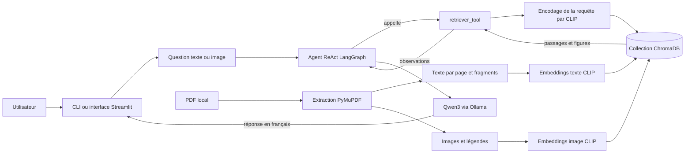

# RAG multimodal agentique

Application locale de recherche augmentée par récupération (RAG) qui indexe et interroge le texte et les figures d'un document PDF. Le parcours principal associe l'extraction avec PyMuPDF, des embeddings multimodaux CLIP, une base vectorielle ChromaDB et un agent ReAct construit avec LangGraph et un modèle local Ollama. Une interface Streamlit et une interface en ligne de commande sont fournies.

Le projet comprend également une première chaîne de RAG textuel fondée sur LlamaIndex et un modèle d'embeddings BGE. Les deux chaînes sont décrites séparément dans ce rapport.

> **Données de démonstration et droits de diffusion** — Le PDF présent dans l'environnement de développement est *Attention Is All You Need*, ainsi que ses extractions, figures, requêtes d'exemple et index calculés. Le dépôt ne redistribue pas ces ressources. Avant de les partager, obtenir et respecter les autorisations applicables. Pour exécuter le parcours multimodal, fournir localement le PDF à l'emplacement indiqué dans [Installation et configuration](#10-installation-et-configuration) ; le code et les sorties générées restent utilisables sans les versionner.

## Table des matières

1. [Présentation générale](#1-présentation-générale)
2. [Problématique et objectifs](#2-problématique-et-objectifs)
3. [Résumé et description détaillée](#3-résumé-et-description-détaillée)
4. [Architecture globale](#4-architecture-globale)
5. [Technologies et outils](#5-technologies-et-outils)
6. [Fonctionnalités implémentées](#6-fonctionnalités-implémentées)
7. [Méthodologie et fonctionnement](#7-méthodologie-et-fonctionnement)
8. [Description des composants](#8-description-des-composants)
9. [Structure du projet](#9-structure-du-projet)
10. [Installation et configuration](#10-installation-et-configuration)
11. [Prérequis et dépendances](#11-prérequis-et-dépendances)
12. [Lancement du projet](#12-lancement-du-projet)
13. [Exemples d'utilisation](#13-exemples-dutilisation)
14. [Résultats et démonstration](#14-résultats-et-démonstration)
15. [Limites et perspectives](#15-limites-et-perspectives)
16. [Conclusion](#16-conclusion)

## 1. Présentation générale

Ce projet d'ingénierie informatique met en œuvre deux prototypes de question-réponse sur documents :

- **RAG multimodal agentique** : recherche par texte ou image dans un PDF, avec récupération de passages et de figures, puis génération d'une réponse par un agent local.
- **RAG textuel secondaire** : indexation de PDF avec LlamaIndex et BGE, puis interrogation des passages retrouvés avec Ollama.

Le parcours multimodal est le plus complet : il propose une interface Streamlit, une recherche directe, une conversation avec mémoire en session et des scénarios de test enregistrés localement.

## 2. Problématique et objectifs

Un document technique peut contenir des informations réparties entre le texte, les tableaux et les illustrations. Une recherche textuelle seule ne permet pas de retrouver directement une figure à partir d'une image, tandis qu'un modèle de langage seul ne garantit pas une réponse ancrée dans le document.

Le projet vise à :

1. extraire les passages textuels et les figures d'un document PDF ;
2. représenter texte et images dans un espace vectoriel partagé ;
3. retrouver des sources pertinentes pour une requête textuelle ou visuelle ;
4. fournir ces sources à un agent qui peut effectuer plusieurs recherches avant de répondre ;
5. présenter les résultats et le déroulement de l'agent dans une interface locale.

## 3. Résumé et description détaillée

Le programme multimodal traite le PDF configuré dans `src/multimodal/config.py`. PyMuPDF extrait le texte page par page, les images intégrées et, lorsque la page contient suffisamment de tracés vectoriels, une image rendue de la figure. Les légendes détectées sont associées aux images.

Les textes sont segmentés en fragments adaptés à la fenêtre d'entrée de CLIP (60 tokens BPE, avec 10 tokens de chevauchement). Le texte original est conservé dans les fragments. CLIP encode les fragments et les images ; les vecteurs sont normalisés puis enregistrés dans une collection persistante ChromaDB, avec le type de source, la page et le chemin du fichier.

À l'interrogation, la recherche calcule les voisins les plus proches selon la distance cosinus. L'outil `retriever_tool` renvoie les sources à l'agent LangGraph. Le modèle Qwen3, exécuté localement par Ollama, peut choisir une recherche textuelle, visuelle ou les deux. L'interface affiche la conversation, les étapes ReAct, les sources et les figures retrouvées.

## 4. Architecture globale



Le dépôt contient aussi une chaîne textuelle indépendante : `src/indexation.py` construit un index LlamaIndex avec BGE dans `storage/`, puis `src/question.py` utilise cet index et Ollama pour répondre aux questions.

## 5. Technologies et outils

| Technologie | Utilisation constatée dans le code |
|---|---|
| Python | Implémentation des commandes, traitements et interfaces |
| PyMuPDF (`pymupdf`) | Lecture du PDF, extraction de texte et d'images, rendu de figures |
| OpenCLIP (`open-clip-torch`) et PyTorch | Encodage des textes et images par `ViT-B-32` préentraîné `laion2b_s34b_b79k` |
| ChromaDB | Stockage persistant et recherche vectorielle cosinus du parcours multimodal |
| LangChain | Découpage du texte et intégration du modèle Ollama |
| LangGraph | Graphe d'agent ReAct, appels d'outils et mémoire en processus |
| Ollama / Qwen3 | Inférence locale avec le modèle configuré `qwen3:14b` |
| Streamlit | Interface web locale à quatre onglets |
| LlamaIndex et BGE | Indexation et interrogation de la chaîne textuelle secondaire |
| Pillow | Lecture, conversion et assemblage d'images |

Les dépendances Python sont listées dans [`requirements.txt`](requirements.txt). Les versions ne sont pas épinglées.

## 6. Fonctionnalités implémentées

### Parcours multimodal

- Extraction du texte page par page, des images intégrées et de figures vectorielles détectées.
- Extraction et association de légendes de figures.
- Encodage texte-image dans l'espace CLIP avec normalisation L2.
- Indexation persistante dans ChromaDB avec une empreinte SHA-256 du PDF.
- Ignorance de la réindexation d'un document inchangé ; option `--forcer` pour recommencer.
- Recherche directe par texte ou image, filtrable par type de résultat.
- Recherche « tous » séparée par modalité pour retourner des résultats texte et image.
- Agent ReAct avec outil de récupération, citations de pages et mémoire de conversation en mémoire vive.
- Interface Streamlit avec les onglets **Agent**, **Recherche**, **Document** et **Tests**.
- Mode interactif console et commandes de démonstration/tests.

### Parcours textuel secondaire

- Lecture des PDF présents dans `data/` et création d'un index LlamaIndex avec `BAAI/bge-small-en-v1.5`.
- Persistance de cet index dans `storage/`.
- Recherche de passages, construction d'un contexte avec références de page et génération d'une réponse par Ollama.

## 7. Méthodologie et fonctionnement du système

1. **Extraction** — `extraction.py` parcourt le PDF et produit des textes par page, des images et un fichier de légendes.
2. **Vectorisation** — `embeddings.py` charge CLIP une seule fois, encode les deux modalités et normalise les vecteurs. Le code sélectionne CUDA si PyTorch le détecte, sinon le CPU.
3. **Indexation** — `indexation.py` segmente le texte, calcule l'identifiant du document à partir du PDF et enregistre fragments, embeddings et métadonnées dans ChromaDB.
4. **Recherche** — `recherche.py` encode la requête, puis interroge la collection. Les fragments textuels peuvent être retournés avec leurs fragments voisins pour donner davantage de contexte.
5. **Agent** — `agent.py` relie le nœud du modèle à `retriever_tool` par un cycle ReAct : raisonnement, action, observation, puis réponse ou nouvel appel.
6. **Présentation** — `app.py` expose l'agent, la recherche, le document extrait et le rapport de tests dans Streamlit.

Le code explique un écart de similarité entre modalités pour CLIP : une requête textuelle sans filtre peut être dominée par les résultats texte. L'option « tous » effectue donc une recherche distincte pour les textes et pour les images.

## 8. Description des composants

| Fichier | Responsabilité |
|---|---|
| `src/multimodal/config.py` | Chemins locaux, modèle CLIP, taille des fragments et configuration de l'agent |
| `src/multimodal/extraction.py` | Extraction PDF, détection/rendu de figures et création de planches d'images |
| `src/multimodal/embeddings.py` | Chargement et encodage CLIP pour texte et image |
| `src/multimodal/indexation.py` | Collection ChromaDB, empreinte du document, segmentation et indexation |
| `src/multimodal/recherche.py` | Recherche directe, récupération de sources et démonstrations |
| `src/multimodal/agent.py` | Outil `retriever_tool`, graphe ReAct, conversation et mode console |
| `src/multimodal/app.py` | Application Streamlit |
| `src/multimodal/main.py` | Point d'entrée CLI et dispatch des commandes |
| `src/multimodal/tests_agent.py` | Sept scénarios d'essai et génération d'un rapport Markdown |
| `src/lecture_pdf.py` | Lecture textuelle des PDF par LlamaIndex |
| `src/indexation.py` | Construction de l'index textuel LlamaIndex/BGE |
| `src/question.py` | Recherche dans l'index textuel et génération via Ollama |

## 9. Structure du projet

```text
rag_multimodal/
├── .gitignore
├── README.md
├── requirements.txt
├── data/                       # PDF d'entrée local, non versionné
├── src/
│   ├── indexation.py            # chaîne textuelle LlamaIndex
│   ├── lecture_pdf.py           # lecture textuelle LlamaIndex
│   ├── question.py              # questions sur l'index textuel
│   └── multimodal/
│       ├── agent.py
│       ├── app.py
│       ├── config.py
│       ├── embeddings.py
│       ├── extraction.py
│       ├── indexation.py
│       ├── main.py
│       ├── recherche.py
│       └── tests_agent.py
├── chroma_pdf/                  # index Chroma généré, non versionné
├── resultats_pdf/               # extractions générées, non versionnées
├── requetes/                    # images de requête locales, non versionnées
├── sorties/                     # démonstrations et rapports générés
└── storage/                     # index LlamaIndex généré, non versionné
```

Les quatre derniers dossiers de données et de résultats ne sont pas inclus dans le dépôt. Ils sont créés ou remplis localement au fil de l'exécution ; le PDF d'entrée doit être fourni séparément.

## 10. Installation et configuration

Les commandes ci-dessous sont destinées à PowerShell sous Windows. Depuis la racine du projet :

```powershell
py -m venv .venv
.\.venv\Scripts\Activate.ps1
python -m pip install --upgrade pip
pip install -r requirements.txt
```

Si l'exécution des scripts PowerShell est désactivée, activer l'environnement avec :

```powershell
.\.venv\Scripts\activate.bat
```

Installer et démarrer [Ollama](https://ollama.com/), puis récupérer le modèle configuré :

```powershell
ollama pull qwen3:14b
```

Placer une copie du PDF autorisée à l'usage dans :

```text
data\Attention is all you need.pdf
```

Le nom et le chemin par défaut sont définis par `PDF_PATH` dans `src/multimodal/config.py`. Le parcours textuel secondaire lit les fichiers PDF présents dans `data/`.

Au premier lancement, OpenCLIP peut télécharger les poids pré-entraînés. Le code désactive le téléchargement Xet et peut activer le mode hors ligne si ces poids existent déjà dans le cache Hugging Face de l'utilisateur.

## 11. Prérequis et dépendances

- Windows, macOS ou Linux avec Python et `pip` ; la version observée dans l'environnement de développement est Python 3.12.3. Le projet ne déclare pas de version minimale.
- Ollama installé et en cours d'exécution pour l'agent et les réponses textuelles.
- Modèle Ollama `qwen3:14b` disponible localement.
- Connexion initiale potentiellement nécessaire pour télécharger le modèle CLIP ; espace disque et mémoire suffisants pour les poids et l'index.
- GPU compatible CUDA facultatif ; le code utilise le CPU si CUDA n'est pas disponible.
- Pour la chaîne textuelle secondaire, les dépendances LlamaIndex et son intégration Hugging Face figurent également dans `requirements.txt`.

Le modèle local peut être exigeant en mémoire et son temps de réponse dépend du matériel. Aucune clé API distante n'est requise par le parcours décrit dans le code.

## 12. Lancement du projet

Les commandes du parcours multimodal doivent être exécutées depuis `src\multimodal` :

```powershell
cd C:\chemin\vers\rag_multimodal\src\multimodal
```

Indexer le PDF (cette commande lance également l'extraction si nécessaire) :

```powershell
python main.py indexer
```

Forcer une nouvelle extraction et indexation :

```powershell
python main.py indexer --forcer
```

Démarrer l'interface web :

```powershell
python main.py interface
```

Streamlit affiche l'adresse locale, habituellement `http://localhost:8501`. Le mode console interactif est disponible avec `python main.py agent`.

Pour le parcours textuel secondaire, depuis la racine du dépôt :

```powershell
python src\indexation.py
python src\question.py
```

## 13. Exemples d'utilisation

Depuis `src\multimodal` :

```powershell
# Extraire le texte et les images du PDF
python main.py extraire

# Vérifier les embeddings (après extraction)
python main.py embeddings

# Recherche de passages textuels
python main.py rechercher "multi-head attention" --type texte -k 5

# Recherche de figures à partir d'une requête textuelle
python main.py rechercher "Transformer model architecture" --type image -k 3

# Recherche à partir d'une image locale fournie par l'utilisateur
python main.py rechercher --image ..\..\requetes\mon_image.png --type image -k 3

# Exemples textuels et visuels
python main.py demo-recherche

# Agent conversationnel et scénarios d'essai
python main.py agent
python main.py tests
```

Dans l'interface web, l'onglet **Recherche** accepte une question textuelle ou une image et permet de choisir la modalité et le nombre de résultats. L'onglet **Agent** accepte une question en français et une image facultative.

## 14. Résultats et démonstration

Un rapport local de sept scénarios existe dans `sorties/rapport_tests.md`. Il couvre une question factuelle, une recherche texte-vers-figure, une requête image, une question combinant texte et figure, un suivi de conversation, une information absente et une salutation. Le programme écrit aussi les planches de figures et les traces dans `sorties/`.

Observations consignées dans ce rapport local :

| Scénario | Observation rapportée |
|---|---|
| Question textuelle sur des paramètres | 5 appels de recherche texte ; réponse avec valeurs et références de pages |
| Texte vers figure | 2 appels ; figures et passages retournés |
| Requête par image | 1 appel avec chemin d'image ; figures classées par similarité |
| Question combinant résultats et figure | 3 appels répartis entre texte et image |
| Question de suivi | 0 nouvel appel ; le modèle réutilise le contexte de conversation |
| Information absente | 0 appel dans l'exécution enregistrée, malgré la règle prévue dans le prompt |
| Salutation hors sujet | 0 appel, conformément au comportement attendu |

Les temps enregistrés dans ce rapport varient de 41 à 345 secondes par scénario. Ils sont propres à cette exécution et au matériel utilisé, et ne constituent pas une mesure de performance reproductible. Les scénarios sont des essais d'intégration qui génèrent un rapport ; le code ne définit pas d'assertions automatiques de réussite/échec.

## 15. Limites et perspectives

### Limites observables

- Le parcours multimodal est configuré pour un PDF et un nom de fichier précis ; le chemin peut être adapté dans `config.py`.
- L'extraction du texte scanné n'est pas associée à un OCR dans le code.
- CLIP accepte une entrée textuelle limitée ; les fragments de 60 tokens et leur chevauchement constituent un compromis propre à cette configuration.
- Le modèle Qwen3 traite le texte et les métadonnées des images, pas directement leurs pixels ; les figures sont montrées à l'utilisateur via l'interface.
- La décision d'appeler l'outil reste prise par le modèle. Le rapport contient un cas où une question sur une information absente n'a pas déclenché de recherche.
- La mémoire de LangGraph utilise `InMemorySaver` : elle n'est pas persistée après l'arrêt du processus.
- Les scénarios de tests sollicitent le modèle local et leurs durées et réponses peuvent varier.
- Les scripts textuels et multimodaux ont des index et des dépendances distincts.

### Améliorations envisageables

- Paramétrer le document, les modèles et les chemins sans modifier le code.
- Ajouter des tests automatisés avec assertions sur la récupération, la provenance et les cas d'information absente.
- Évaluer la précision du classement multimodal sur un jeu de requêtes annoté.
- Ajouter OCR, prise en charge de plusieurs documents et indexation incrémentale multi-fichiers.
- Ajouter une persistance configurable de l'historique et des mécanismes de gestion des erreurs plus visibles dans l'interface.
- Documenter et verrouiller les versions de dépendances après validation sur les environnements cibles.

## 16. Conclusion

Le projet met en œuvre un prototype complet de RAG multimodal local, du traitement du PDF jusqu'à la recherche vectorielle, à l'agent outillé et à l'interface utilisateur. Il comporte également une chaîne textuelle fondée sur LlamaIndex. La séparation entre le code et les données de démonstration permet de partager les composants logiciels sans redistribuer le PDF, ses extractions, les figures ou les index dérivés.
